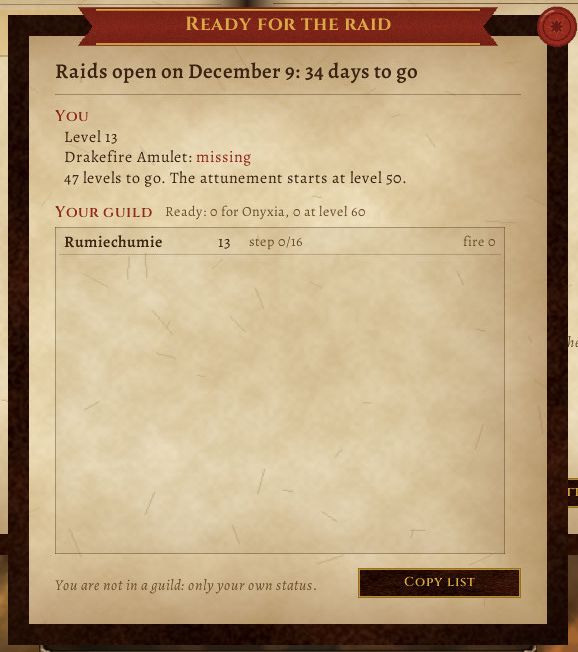

# Listos para la raid ("Ready for the raid")

On December 9 the first **WoW Forever** raids open: The Barrow Deeps (10 players), Hyjal Summit (20) and Onyxia's Lair (40). This addon shows how much you have left and, if your guild has it too, how everyone is doing.

[Leer en castellano](README.md)

- **Countdown** to 12/9.
- **You:** level, whether you hold the Drakefire Amulet (bags or bank), your step in Onyxia's attunement (16 for the Alliance, 14 for the Horde), fire resistance, and which raids you are ready for.
- **Your guild:** everyone's level, amulet or step, and fire, ready players first, with "Ready: 12 for Onyxia, 20 at level 60" on top.
- **Copy list:** the guild as CSV text for a spreadsheet or RaidCalendar's notes. `/listos` opens it, `/listos copy` gives you the list, `/listos lang es|en|auto` picks the language whatever the client's, and `/listos minimap off` hides the minimap button (click: opens the page; drag it around the minimap).
- **Your own row** is always in the list, guild or not.
- **The look:** one parchment page in a leather cover, ink and manuscript type (Alegreya and Cinzel, OFL, shipped inside), the guild as a list with a gold seal on whoever can already enter Onyxia, a wax seal to close. The same skin as Bitácora, Recordame, the Bingo and Taller: the [Pergamino](https://github.com/JoseArgento/pergamino) library, vendored in `Libs/Pergamino` (own textures, no Blizzard art).

In Forever the amulet is per character and the "Chipped" one is not sold, so everyone runs the chain.

**What it sends:** one line of numbers on the GUILD channel only (`S|1|60|1|16|16|130`), when something changed or someone asks. Only numbers in sensible ranges are kept, at most 5 messages per 10 seconds per sender, up to 1000 people. Nothing received is run. Trial accounts cannot send addon messages: the addon notices and only listens.

**Tested**: every API checked against Forever 1.60.1 (`tools/check_api.py`); fire resistance is read the way Forever's character sheet does; forever-lint only shows the FL012 note (handled); Addon Sentry finds nothing; 33 tests in Lua 5.1 with several guildmates. **In the client** (since launch): the page, your own status, the countdown, "Copy list" and the minimap button, without a guild. **Not seen yet**: the attunement quest IDs are Classic's as Forever guides list them (with the amulet in hand you show as ready anyway), the exact opening hour, the 100 fire resistance target (a common reference, not official), and the list with a whole guild running it.

**If something breaks:** `/listos errores` shows the addon's last error (the last 10 are kept, no popups) to copy into a GitHub issue.

## Support

All of this is free and open source, and it stays that way: no paid features, nothing early for supporters. If it helped you and you want to cover the time it takes to keep it working (every Blizzard patch means refreshing the data and fixing what broke), you can do that on [Patreon](https://www.patreon.com/cw/DoblePupi). Thanks ♥

Not affiliated with Blizzard Entertainment. MIT license.
