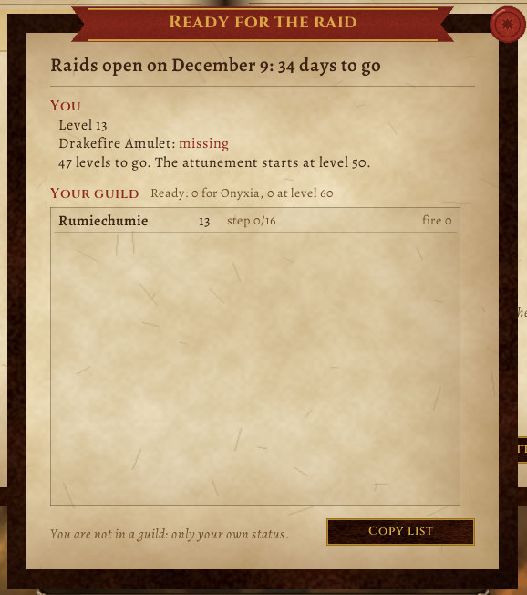

# Listos para la raid

El 9 de diciembre abren las primeras raids de **WoW Forever**: The Barrow Deeps (10 jugadores), Cima Hyjal (20) y la Guarida de Onyxia (40). Este addon te dice cuánto te falta y, si tu guild también lo tiene, cómo vienen todos.

[Read in English](README.en.md)



**Contenido**

- [Qué muestra](#qué-muestra)
- [Qué manda y qué recibe](#qué-manda-y-qué-recibe)
- [Instalar](#instalar)
- [Cómo se probó](#cómo-se-probó)
- [Desarrollo](#desarrollo)
- [Apoyar](#apoyar)

## Qué muestra

- **La cuenta regresiva** al 9/12.
- **Tu estado:** nivel, si tenés el Amuleto de Fuego Dracónico (en bolsas o banco), en qué paso de la sintonización de Onyxia vas (16 pasos en la Alianza, 14 en la Horda) y tu resistencia al fuego. Abajo, para qué raids ya estás listo.
- **Tu guild:** cada uno con nivel, amuleto o paso, y fuego, con los listos arriba. Arriba de todo, "Listos: 12 para Onyxia, 20 en nivel 60".
- **Copiar lista:** la guild como texto (`nombre,nivel,amuleto,paso,pasos,fuego`) para pegar en una planilla o en las notas de RaidCalendar.
- `/listos` abre la página, `/listos copiar` te da la lista, `/listos idioma es` (o `en`, o `auto`) elige el idioma aunque el cliente esté en otro, `/listos minimapa off` esconde el botón del minimapa (clic: abre la página; se arrastra alrededor del minimapa) y `/listos minimapa juntar on` junta los botones de toda la familia de addons en uno solo con menú.
- Tu propia fila está siempre en la lista, tengas guild o no.

## Cómo se ve

Una sola página de pergamino dentro de una tapa de cuero, con tinta y tipografía de manuscrito (Alegreya y Cinzel, licencia OFL, van dentro del addon): la cuenta regresiva en grande, tu estado en tinta (verde o carmesí para el amuleto), la guild como lista con los listos arriba y un sello dorado para quien ya puede entrar a Onyxia, y "Copiar lista" en una tarjeta de pergamino. El sello de lacre cierra. Es la misma piel que usan Bitácora, Recordame, el Bingo y Taller: la librería [Pergamino](https://github.com/JoseArgento/pergamino), que viene copiada en `Libs/Pergamino` (texturas propias, nada de arte de Blizzard).

En Forever el amuleto es **por personaje** y no se vende la versión "Chipped" de otros Classic, así que cada uno tiene que hacer la cadena.

## Qué manda y qué recibe

- **Manda** por el canal de la guild, y nada más, una línea de números: `S|1|60|1|16|16|130` (nivel, amuleto, paso, pasos, fuego). Solo cuando algo cambió, o cuando alguien la pide.
- **Recibe** solo de la guild, solo números en rangos que tienen sentido, como mucho 5 mensajes cada 10 segundos por persona, y guarda hasta 1000 personas. Nunca ejecuta nada de lo que llega.
- **Cuentas de prueba:** Forever no las deja mandar mensajes de addon. El addon se da cuenta y no intenta: ves a tu guild, ellos no te ven a vos.

## Instalar

Copiá la carpeta `ListosParaLaRaid` a `Interface\AddOns\`, dentro de la carpeta de Forever del juego.

## Cómo se probó

**Probado:**
- ✅ Cada función y evento existe en Forever 1.60.1 (`tools/check_api.py` contra los dumps de [Ketho/BlizzardInterfaceResources](https://github.com/Ketho/BlizzardInterfaceResources) y la UI de [Gethe/wow-ui-source](https://github.com/Gethe/wow-ui-source), rama `forever`). La resistencia se lee igual que la ficha de personaje de Forever: `UnitResistance(unidad, Enum.Damageclass.Fire)`, tercer valor.
- ✅ [forever-lint](https://github.com/JoseArgento/forever-lint): solo la nota FL012 (cuentas de prueba), que el addon ya maneja. [Addon Sentry](https://github.com/JoseArgento/addon-sentry): "Sin señales de riesgo".
- ✅ **36 tests** en Lua 5.1, con varios jugadores de la misma guild pasándose el estado.

**En el cliente** (desde el lanzamiento): la página, el estado propio, la cuenta regresiva, "Copiar lista" y el botón del minimapa, sin guild.

**Todavía sin ver ⏳:**
- **Los IDs de las misiones** de la sintonización son los de Classic, como los listan las guías de Forever. Si Forever cambió alguno, ese paso no se marca, pero con el amuleto en la mano te da listo igual.
- **La hora** en que abren las raids: depende del reinicio semanal de cada región. El addon cuenta días.
- **La resistencia al fuego "objetivo"** (100) es una referencia común, no un número oficial de Blizzard.
- La lista con una guild entera usando el addon.

**Si algo falla:** `/listos errores` muestra el último error del addon (se guardan los últimos 10, sin popups) para copiarlo en un issue de GitHub.

## Desarrollo

```bash
pip install pytest lupa
pytest
python tools/check_api.py --bir ../BlizzardInterfaceResources --ui ../wow-ui-source --scanner ../addon-sentry/src
```

Fuentes: [anuncio de las raids](https://www.gamerfuzion.com/world-of-warcraft-forever-raids-december-9-barrow-deeps-hyjal-summit-onyxia-attunement/) · [la sintonización de Onyxia en Forever](https://conquestcapped.com/guides/wow-forever/wow-forever-onyxia-attunement/).

## Apoyar

Todo esto es gratis y de código abierto, y va a seguir así: no hay funciones pagas ni nada antes para quien aporta. Si te sirvió y querés bancar el tiempo de mantenerlo (con cada parche de Blizzard hay que actualizar los datos y arreglar lo que se rompe), podés hacerlo en [Patreon](https://www.patreon.com/cw/DoblePupi). Gracias ♥

Sin relación con Blizzard Entertainment. World of Warcraft es marca registrada de Blizzard Entertainment, Inc. Licencia MIT.
